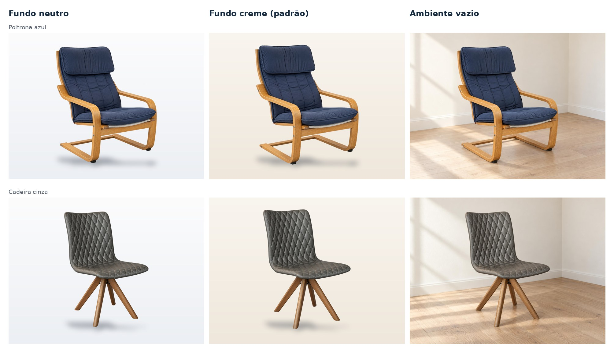

# Estúdio de fotos e 3D (painel)

Na página de cada produto, o painel tem o **Estúdio de fotos e 3D**:

1. **Fotos do celular**: o funcionário envia 3 ou 4 fotos (frente, lateral, traseira) com qualquer fundo. O navegador
   reduz fotos grandes antes de enviar (limite de 4 MB por arquivo).
2. **Limpeza de fundo automática**: cada foto vira uma foto de estúdio 4:3, com fundo creme e sombra suave. O painel
   mostra **antes × depois**. Se um móvel ao fundo “grudou” na máscara, ele é retirado automaticamente. Essas fotos são
   referência (não vão para a loja).
3. **Modelo 3D** gerado a partir da foto escolhida, com prévia girando no painel. Fica marcado como **ilustrativo** até
   alguém revisar.
4. **Vídeo (opcional)**: enviado na seção de mídia.

Categorias marcadas com **“Exige modelo 3D para publicar”** (como “Cadeiras e poltronas”) só publicam com 3D. Fotos são
sempre obrigatórias; vídeo é opcional.

## Como funciona

```
Painel (Next.js)  ──cria job──▶  ai_jobs (Supabase)  ◀──pega 1 por vez──  Processador (scripts/ai-worker.mjs)
       ▲                                                                       │ roda ai/*.py (CPU)
       └────────── acompanha a cada 2 s ◀── grava a foto/3D como mídia ◀────────┘
```

- O painel só **cria** e **acompanha** jobs (RLS: equipe, produto editável, arquivo da pasta do produto). Quem muda o
  status e grava o resultado é o processador, com a chave de serviço.
- O processador roda numa máquina da loja ou num servidor (nunca no navegador nem na Vercel). Ele avisa que está ligado
  (tabela `ai_workers`) e o painel mostra quais motores estão disponíveis.
- Arquivos: `products/<id>/originais/` (foto enviada), `products/<id>/recortes/` (recorte com transparência, base do
  3D) e `products/<id>/<uuid>.jpg|.glb` (resultado).

## Instalar e rodar

```bash
npm run ai:setup    # uma vez: ambiente Python (CPU) + modelos (~1,1 GB)
npm run ai:worker   # deixe rodando; lê .env.local (URL do Supabase + chave de serviço)
```

Requisitos: Python 3.11+, ~4 GB de RAM livres e ~3 GB de disco. Não precisa de placa de vídeo.

Tempo medido (4 vCPUs, sem GPU): **35 a 45 s por foto**. As fotos são processadas uma por vez, na ordem de envio.

## Modelos (todos abertos, rodando localmente; nenhuma foto sai da máquina)

| Etapa | Modelo | Licença |
| --- | --- | --- |
| Separar objeto e fundo | [BiRefNet](https://huggingface.co/onnx-community/BiRefNet-ONNX) (ONNX) | MIT |
| Tirar móveis ao fundo | [Depth Anything V2 Small](https://huggingface.co/depth-anything/Depth-Anything-V2-Small-hf) | Apache-2.0 |
| 3D (opcional, ver abaixo) | [TripoSR](https://huggingface.co/stabilityai/TripoSR) | MIT |

## 3D automático (API do Tripo)

**Funcionando** com `TRIPO_API_KEY` no `.env.local` do processador (conta em https://platform.tripo3d.ai, créditos
pré-pagos a partir de US$ 1). Modelo padrão `v3.1-20260211` (troque com `TRIPO_MODEL`).

- **Base do 3D:** com fotos de catálogo prontas, o processador envia **frente, lado direito e costas** (modo de várias
  fotos do Tripo) — a traseira e o perfil saem fiéis (ex.: as ripas de madeira nas costas da poltrona). Sem fotos de
  catálogo, usa uma foto limpa só (a traseira é estimada).
- **Pós-processamento:** o modelo é girado para abrir de frente no visualizador (o Tripo exporta com a frente em +X) e
  o modelo é apoiado no chão (base em y = 0) e as texturas são comprimidas em JPEG até caber em 4 MB. JPEG, e não
  WebP, porque o AR do Android (Scene Viewer) só abre JPEG/PNG.
- **Medido com a poltrona azul (28/10/2026):** 30 créditos (**US$ 0,30**) por modelo, ~2 min 15 s, arquivo de 4,6 MB →
  2,2 MB depois da compressão em WebP (2,75 MB na versão em JPEG, que abre no AR do Android).
- O 3D entra marcado como **ilustrativo** até alguém conferir com as fotos reais.

Alternativa local (TripoSR, grátis, qualidade menor): `AI_3D_ENGINE=triposr` com o código em `ai/vendor/TripoSR`
(ainda não validado neste ambiente — a execução de código de terceiros precisa de autorização).

## Fotos de catálogo: a IA recria a cena (padrão da loja)

Problema que resolve: o vendedor fotografa de qualquer jeito — torto, de um ângulo ruim, com uma peça escondida ou um
pouco borrado. A limpeza de fundo só recorta o que está na foto (se o braço da poltrona some num recorte, ele continua
faltando). As **fotos de catálogo** recriam a cena:

- **Sempre os mesmos 4 ângulos** para todos os produtos: frente, ¾ (a foto principal típica de e-commerce), lateral e
  traseira; câmera na altura do meio do objeto, luz de estúdio suave, fundo claro.
- **Referência = todas as fotos reais** do produto (3 a 4 ângulos): o que uma foto esconde, outra mostra.
- **O produto não muda**: mesma forma, proporções, peças, cores, tecido, costuras e acabamento da madeira. Se algo não
  aparece em nenhuma foto, a IA não inventa: a equipe tira outra foto.
- Cada imagem gerada passa pela mesma limpeza e enquadramento das fotos comuns (escala, posição e sombra iguais).
- **Nada vai para a loja sem conferência**: a imagem nasce “aguardando conferência”; alguém compara com as fotos reais
  (lado a lado no painel) e aprova marcando “Conferi: cor, formato, peças e acabamento são iguais”. O banco registra
  quem aprovou e quando (auditoria). Imagem não aprovada não aparece para o público e não pode ser a principal.
- Na loja, essas imagens trazem o aviso discreto “Cena recriada a partir das fotos reais”.

**Estado: funcionando** com a API da OpenAI (`OPENAI_API_KEY` no `.env.local` do processador). Modelo padrão
`gpt-image-2.5-sunburst` (troque com `OPENAI_IMAGE_MODEL`), edição com todas as fotos reais como referência, fundo
transparente, 1536×1024, qualidade alta. Medido com as duas cadeiras reais (28/10/2026): **~40 s por imagem** (2 em
paralelo, ~1,5 min para os 4 ângulos) e **~US$ 0,08 por imagem** (~4,7 mil tokens de entrada + ~1,4 mil de saída) →
**~US$ 0,35 por produto**. Alternativa com a mesma chave da fal.ai do 3D: Nano Banana Pro (~US$ 0,15 por imagem).

Instrução enviada ao modelo (por ângulo; ver `catalogPrompt` em `scripts/ai-worker.mjs`):

> Use the attached photos only as the source of truth for this exact product. Create a professional e-commerce studio
> photograph of the same product: {view}, camera at the product's mid height, 50 mm lens, light grey seamless background,
> soft diffused light, subtle contact shadow, whole product in frame. Preserve exactly its shape, proportions, number and
> position of parts, colors, materials, fabric and stitching pattern, wood grain and finish, wear marks. Do not add,
> remove, repair or redesign anything; no props, text or logos. Straighten the camera and fix blur only.

## Estilo das fotos de catálogo (fundo)

**Decisão do dono do projeto (28/10/2026): fundo creme (B)** — o produto recortado sobre um creme quente, com sombra
suave, igual para todos os produtos. Outras opções prontas (variável `CATALOG_STYLE` do processador):

| Estilo | Valor | Como é feito |
| --- | --- | --- |
| **Fundo creme (padrão)** | `creme` | Enquadramento padrão da loja sobre creme (`#F9F5EF` → `#EFE7DB`) |
| Fundo claro neutro | `neutro` | O mesmo, sobre cinza-claro |
| Ambiente vazio | `ambiente-vazio` | O produto no **mesmo cômodo vazio** para todos (`ai/cenarios/ambiente-vazio.jpg`: paredes creme, piso de madeira clara, luz de janela), sem nenhum outro móvel ou objeto. +1 chamada à OpenAI por foto |



Pesquisa que embasou as opções (27–28/10/2026):

- **O que as lojas de referência fazem** (vimos as páginas): Mobly — produto recortado em fundo branco (`#FAFAFA`);
  IKEA — fundo branco puro, ambientes em blocos separados; **Westwing** — produto recortado em **fundo creme**
  (`#FAF6F3`) e, no produto, 4 ângulos + 3 closes de textura/costura. Marketplaces (Mercado Livre, Amazon) exigem fundo
  branco na foto principal (o Mercado Livre admite contexto em algumas categorias de casa e móveis).
- **Dados (Baymard):** 79% das pessoas vão primeiro às fotos na página do produto; 42% tentam avaliar o tamanho do
  móvel pelas fotos; 38% consideram fotos ambientadas/em escala essenciais para decidir se cabe. Ganhos de 20–40% com
  fotos ambientadas aparecem em blogs de fornecedores, sem estudo sólido; nenhuma fonte mostrou creme × branco.
- Por isso: fundo uniforme e neutro-quente como padrão (cara premium, sem poluição na grade da loja) e o ambiente
  vazio disponível como opção. Medir com teste A/B quando houver tráfego.

**As fotos do celular limpas não vão para a galeria da loja**: servem de antes × depois, de referência para a IA e
de base para o 3D. A loja recebe só as fotos de catálogo **aprovadas**; a primeira aprovada vira a foto principal.

## Nome e textos da loja com IA

**Funcionando** no painel (seção 5 do estúdio), com a mesma `OPENAI_API_KEY` no servidor do Next.js (modelo padrão
`gpt-5.1`; troque com `OPENAI_TEXT_MODEL`). O ChatGPT recebe as fotos (as aprovadas primeiro) e **só os dados
confirmados** e sugere 3 nomes, descrição curta, descrição completa e textos para o Google. Regras na instrução:
não inventar medidas, materiais, garantia, certificações ou benefícios; o que não foi confirmado é descrito só pela
aparência (ex.: “estrutura em tom de madeira clara”). Se o texto citar um número que não está nos dados confirmados, o
painel avisa antes de aplicar. Nada é salvo sem a pessoa revisar e clicar em “Aplicar ao produto”. Limite: 10 pedidos a
cada 10 minutos por pessoa. Leva ~8 s e custa centavos.
