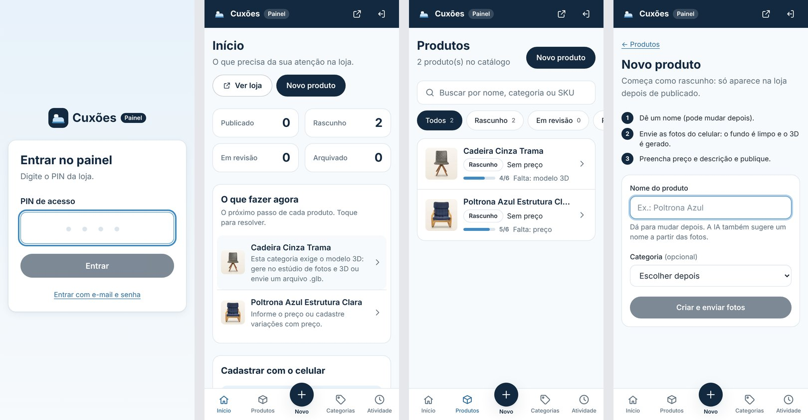
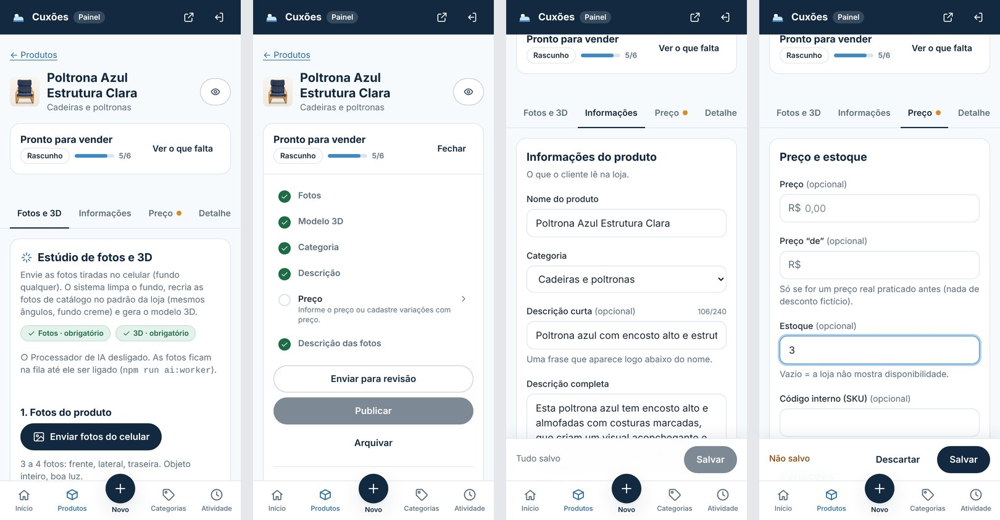

# Painel da loja (`/admin`)

Feito para cadastrar e vender pelo celular, sem precisar de manual: cada tela mostra o que falta e leva direto ao
lugar de resolver.




## Entrar: uma senha por área

- Abra **`/admin`** e digite a **senha de acesso**. Cada senha abre só a sua parte do painel:

| Senha | Variável | Abre |
| --- | --- | --- |
| **Geral** | `ADMIN_PIN` | Tudo: itens, pedidos, entrega e avisos, publicação e o atalho para o Trama (fábrica e logística) |
| **Itens** | `ADMIN_SENHA_ITENS` | Produtos, fotos e 3D, categorias e o histórico do catálogo (publicar continua com a geral) |
| **Pedidos** | `ADMIN_SENHA_PEDIDOS` | Pedidos, avisos ao cliente e o andamento na fábrica e na logística (Trama) |
| **Entrega** | `ADMIN_SENHA_ENTREGA` | Formas de entrega (frete por região) e os avisos automáticos |

- Quem entra por uma área vê só o menu e as telas dela; abrir o endereço de outra área volta para o início com o aviso
  "Essa parte é de outra área".
- “Entrar com e-mail e senha” continua disponível para cada pessoa da equipe usar a própria conta.
- **Sair** fica no menu lateral (computador) ou no ícone do topo (celular).
- Depósito, rotas, entregadores, fábrica e financeiro ficam no **Trama**, cada área com a própria senha lá
  ([`INTEGRACAO-TRAMA.md`](INTEGRACAO-TRAMA.md)); o início do painel, com a senha geral, tem o atalho.

### Senhas de teste

Para testar agora, use senhas fáceis em sequência (troque por senhas longas antes de vender de verdade):

| Variável (Vercel ou `.env.local`) | Senha de teste | Abre |
| --- | --- | --- |
| `ADMIN_PIN` | `1234` | Tudo (geral) |
| `ADMIN_SENHA_ITENS` | `2345` | Itens |
| `ADMIN_SENHA_PEDIDOS` | `3456` | Pedidos |
| `ADMIN_SENHA_ENTREGA` | `4567` | Entrega e avisos |

### Como funciona (e por que é seguro o bastante para o MVP)

A senha **não** substitui as contas da equipe. Quando confere, o servidor entra numa conta de verdade do Supabase:

- a **geral** entra na conta `ADMIN_PIN_EMAIL` / `ADMIN_PIN_PASSWORD` (administradora, senha longa que nunca vai ao
  navegador);
- cada **área** entra numa conta própria, derivada da geral (`painel+itens@…`, `painel+pedidos@…`, com senha calculada
  no servidor). Ela é criada sozinha no primeiro acesso, com a chave de serviço (`SUPABASE_SERVICE_ROLE_KEY`), e fica
  ligada só àquela área (`admin_users.areas`).

A separação vale **no banco**, não só na tela: as políticas de acesso (RLS) exigem a área em cada tabela
(`supabase/migrations/20261104000200_areas_do_painel.sql`). Quem tem a sessão da área de itens não lê pedidos nem
chamando a API do Supabase direto. O histórico continua registrando quem fez cada alteração (a conta da área).

- Comparação em tempo constante; 5 tentativas a cada 10 minutos por IP.
- Senha de 4 a 64 caracteres, sem espaço. A mesma senha em duas áreas não vale para nenhuma delas.
- Desligado sem `ADMIN_PIN_EMAIL` e `ADMIN_PIN_PASSWORD`, ou sem nenhuma senha.
- **`1234` é só para demonstração.** Antes de vender de verdade, use senhas longas e diferentes em cada área.
- Trocar uma senha de área: mude a variável e faça um novo deploy. Trocar `ADMIN_PIN_PASSWORD` troca também as senhas das
  contas das áreas (o próximo acesso acerta sozinho).
- Contas da equipe criadas antes das áreas (sem área marcada) continuam vendo o que viam.

Para ligar:

```bash
ADMIN_PASSWORD='uma-senha-longa-e-aleatoria' npm run admin:create -- painel@sualoja.com.br admin
# em .env.local (e nas variáveis da Vercel, sem NEXT_PUBLIC_):
ADMIN_PIN=uma-senha-geral-longa
ADMIN_PIN_EMAIL=painel@sualoja.com.br
ADMIN_PIN_PASSWORD=uma-senha-longa-e-aleatoria
ADMIN_SENHA_ITENS=senha-de-quem-cadastra
ADMIN_SENHA_PEDIDOS=senha-do-atendimento
ADMIN_SENHA_ENTREGA=senha-de-quem-cuida-do-frete
SUPABASE_SERVICE_ROLE_KEY=...   # já usada pela IA na nuvem; cria as contas das áreas
```

## Telas

| Tela | Para quê |
| --- | --- |
| **Início** | Quantos produtos em cada status e **“O que fazer agora”**: o próximo passo de cada produto (fotos da IA para conferir, o que falta, ou “já pode publicar”). Toque e cai na aba certa. |
| **Produtos** | Busca, filtro por status e, em cada linha, a barrinha **“Pronto para vender”** (ex.: 5/6) com o que falta. |
| **Novo produto** | Um passo só: nome e categoria → o rascunho é criado e abre direto em **Fotos e 3D**. O endereço (link) é gerado pelo nome. |
| **Categorias** / **Atividade** | Cadastro de categorias e histórico de tudo que mudou. |

No celular, a navegação fica embaixo (Início, Produtos, **+ Novo**, Categorias, Atividade); no computador, no menu
lateral.

### Página do produto

Abas, uma tarefa por vez (o endereço guarda a aba: `?aba=preco`):

| Aba | O que tem |
| --- | --- |
| **Fotos e 3D** | Estúdio de IA (fotos do celular → fundo limpo → fotos de catálogo → 3D) e as fotos que aparecem na loja (ordem, capa, descrição de cada foto). |
| **Informações** | Nome, categoria, descrição curta e completa. |
| **Preço** | Preço, preço “de” (só se for real), estoque, SKU e variações (em colchões, tamanhos com medidas-padrão). |
| **Detalhes** | Medidas (altura, largura, profundidade, peso), materiais, tecido, garantia, cuidados, outras especificações e perguntas frequentes. Firmeza e camadas só aparecem em colchões. |
| **Link e Google** | Endereço na loja e como o produto aparece no Google (com prévia). |

- **Pronto para vender** (lateral no computador; resumo de uma linha no celular, “Ver o que falta”): checklist com as
  **mesmas regras que o banco usa para publicar**. Tocar num item leva à aba dele. As abas com pendência têm um ponto
  laranja. Ali ficam também Enviar para revisão, Publicar, Arquivar, Duplicar e Excluir.
- **Barra de salvar fixa** embaixo: mostra “Alterações não salvas”, **Descartar** e **Salvar**. Trocar de aba não
  perde o que foi digitado; fechar ou recarregar a página com algo não salvo pede confirmação. Publicar só depois de salvar.
- Se algo der erro ao salvar, o painel abre a aba do campo com problema e coloca o cursor nele.
- Campo vazio não aparece na loja. Nada de medida, material ou garantia sem confirmação do fabricante.

## Vídeo

Fica para a próxima etapa (o banco e o servidor já aceitam MP4/WebM, mas o envio está fora da tela por enquanto).

## Para desenvolvedores

- Código: `app/admin/(painel)/`, `components/admin/` (`product-editor.tsx`, `product-form.tsx`, `admin-nav.tsx`),
  `lib/admin/readiness.ts` (checklist), `lib/admin/pin.ts` e `lib/admin/actions/auth.ts` (PIN),
  `createProductDraftAction` em `lib/admin/actions/products.ts`.
- Testes: `tests/unit/admin-panel.test.ts`, `tests/unit/admin-actions-auth.test.ts` e
  `tests/e2e-supabase/admin.spec.ts` (`npm run test:e2e:supabase`; os testes apagam os produtos e arquivos que criam).
- O painel online precisa do Supabase na nuvem; sem ele, `/admin` mostra como conectar.
